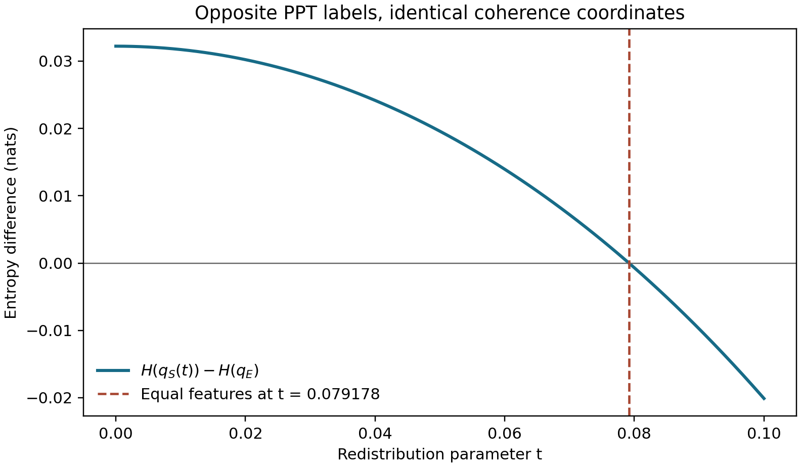

# Opposite entanglement labels, identical coherence features

The question is simple: if a classifier receives four coherence values instead
of the density matrix, can it always determine whether the state is entangled?
For the product bases used in this thesis, the answer is no. We can construct a
separable state and an entangled state with exactly the same input vector.

The result concerns the ordered features `Cr(QS), Cr(RS), Cr(RT), Cr(QT)`.
At basis phase zero these are the product eigenbases `ZX, YX, YZ, ZZ`.
It applies to every fixed phase in the specified basis family after a matching
local rotation. It is not a theorem about arbitrary four-basis choices.

## Follow the construction

Use Bell weights ordered as `(Phi+, Phi−, Psi+, Psi−)`. A Bell-diagonal density
matrix is a convex combination of their four projectors. Its entropy is the
Shannon entropy of its weights, and its partial-transpose eigenvalues are the
multiset `{1/2 − q_j}`. Thus a weight above 1/2 certifies entanglement.

Consider

```text
Entangled: qE    = (0.51, 0.09, 0.20,     0.20)
Separable: qS(t) = (0.49, 0.11, 0.20 + t, 0.20 − t), 0 ≤ t ≤ 0.10
```

The first three measurement distributions are uniform for every Bell-diagonal
state. The last depends only on `q1+q2`, which is 0.60 for both candidates.
Matching the four features therefore reduces to matching one entropy:

```text
H(qS(t)) − H(qE) = 0.
```

This continuous function is positive at zero, negative at 0.10, and strictly
decreasing inside the interval. Hence it has a unique root. The endpoint signs
are checkable using integer arithmetic, so the existence argument does not rely
on a floating-point residual. The full proof is in
[`coherence_limitation.tex`](../thesis/sections/coherence_limitation.tex).

The approximate solution and resulting quantities are:

```text
t                    = 0.079178202144160...
qS                   = (0.49, 0.11, 0.279178202144160..., 0.120821797855840...)
minimum PPT value E  = −0.01
minimum PPT value S  = +0.01
common features      = (0.182398369203061..., 0.182398369203061...,
                        0.182398369203061..., 0.162262855652373...) nats
```

Both states are full-rank. They have opposite labels away from the numerical
PPT tolerance. A deterministic classifier receives the same exact input for
both, so it cannot assign both labels correctly. This does not determine an
error floor under an arbitrary data distribution: that distribution may assign
zero probability to the constructed pair.

## Run the search

From a clean checkout, Python 3.11 is the recorded environment:

```bash
python3.11 -m venv .venv-counterexample
.venv-counterexample/bin/python -m pip install -r requirements-counterexample.txt
.venv-counterexample/bin/python scripts/search_coherence_counterexamples.py \
  --output-dir artifacts/coherence_counterexamples --plot
.venv-counterexample/bin/python -m unittest discover -s tests \
  -p test_counterexample.py -v
```

The optional independent QuTiP test is skipped if QuTiP is absent. To run it,
install `qutip==5.2.3` in this environment, or use the full thesis environment:

```bash
.venv/bin/python scripts/search_coherence_counterexamples.py \
  --output-dir artifacts/coherence_checked --qutip-check --plot
```

The output directory must be empty. The deterministic grid examines seven pair
sums and four PPT-margin parameters. The committed reference run finds 28
collisions in 28 candidates. This number describes this grid, not an exhaustive
search or a probability estimate over quantum states.

## Inspect the code and results

| File | What it does |
|---|---|
| [`counterexample.py`](../asif_reproduction/counterexample.py) | Constructs matrices, evaluates entropies, brackets roots and verifies opposite labels |
| [`search_coherence_counterexamples.py`](../scripts/search_coherence_counterexamples.py) | Runs the canonical example and grid, records versions/hashes and exports artifacts |
| [`test_counterexample.py`](../tests/test_counterexample.py) | Checks independent formulas, phase covariance, physical states and exceptional cases |
| [`results.json`](../thesis/generated/coherence_counterexamples/results.json) | Reference roots, endpoint signs, PPT minima, residuals and provenance |
| [`search.csv`](../thesis/generated/coherence_counterexamples/search.csv) | Compact list of all successful candidates |
| [`canonical_states.npz`](../thesis/generated/coherence_counterexamples/canonical_states.npz) | Numerical density matrices and feature vectors |

```python
import numpy as np
data = np.load("artifacts/coherence_counterexamples/canonical_states.npz")
rho_e = data["rho_entangled"]
rho_s = data["rho_separable"]
print(data["features_entangled"] - data["features_separable"])
```



The direct implementation uses NumPy eigenvalues and basis probabilities. The
optional check instead invokes the thesis's original QuTiP basis factory,
coherence extractor and PPT labeler. Comparing them helps detect an error that
would be missed by checking a formula against itself.

For a nonzero fixed phase `phi`, transform each density matrix with
`diag(1, exp(i*phi)) tensor I`. The local rotation preserves the labels and
matches the rotation of the `R` basis. This produces a corresponding pair for
each phase; it does not say one unrotated pair works simultaneously for all
phases.

## Provenance and scope

The first counterexample was derived by examining the Bell-diagonal feature
formula, choosing opposite-label weights with the same pair sum, and numerically
solving the entropy equation. A separate exact sign-change proof establishes
existence. The deterministic grid search was written subsequently to reproduce
and explore that construction. It is not presented as the original discovery
log or as a blind optimization over arbitrary density matrices.

The checked-in matrices are floating-point approximations to the states defined
by the exact entropy root. Small differences in numerical residuals across
platforms do not change the analytical claim. The JSON report separates these
residuals from the exact integer endpoint certificate.

This example explains a limitation of the representation, not a failure of a
particular training algorithm. It is consistent with high empirical accuracy
on restricted state distributions. Novelty and publication positioning require
comparison with the existing literature; the repository makes no priority or
universal four-feature impossibility claim.
